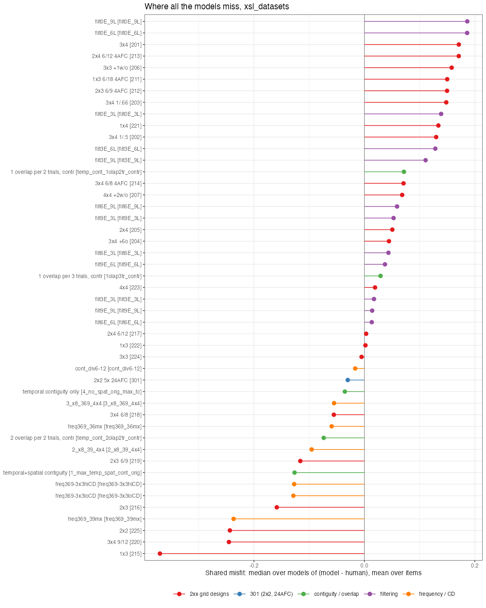
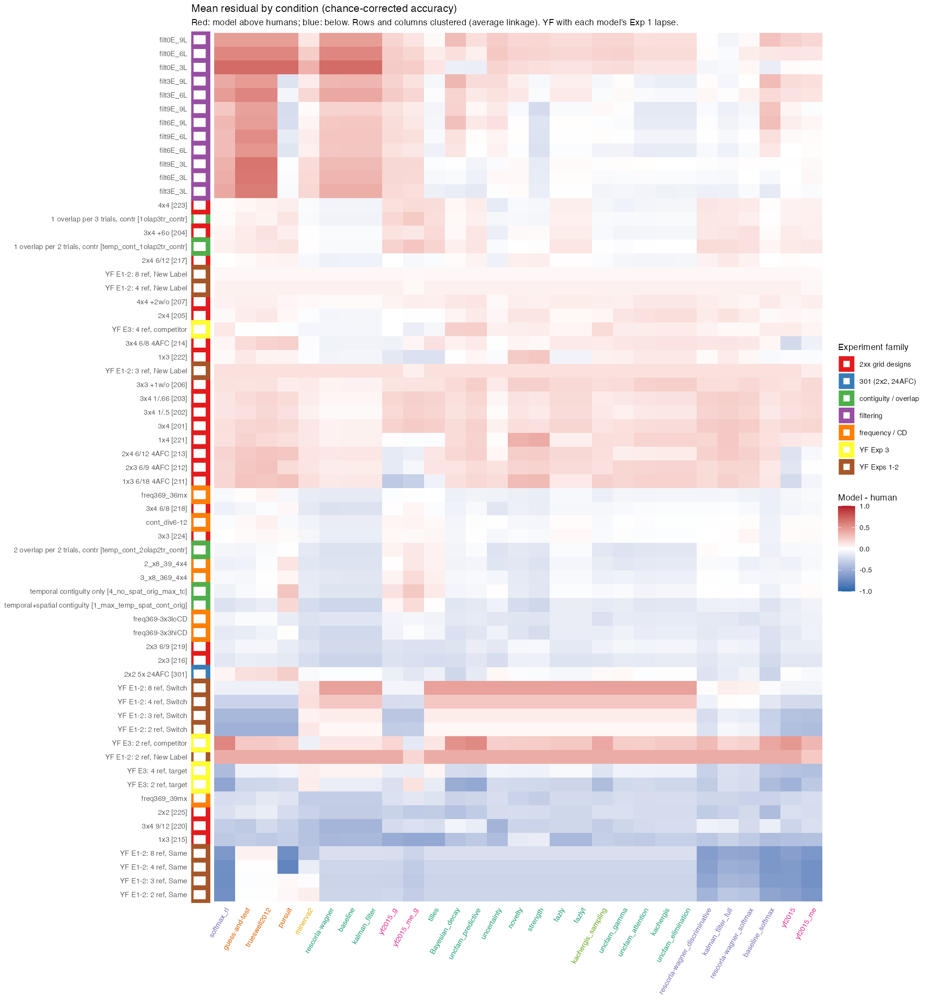
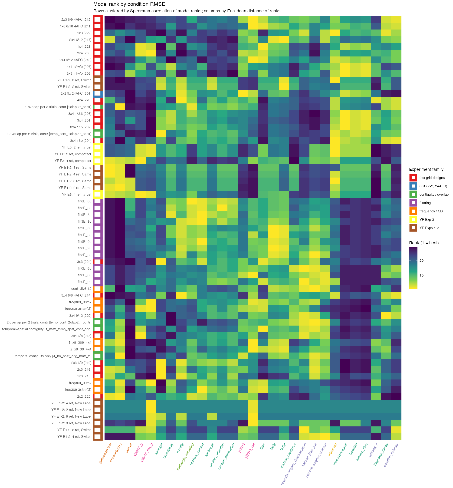
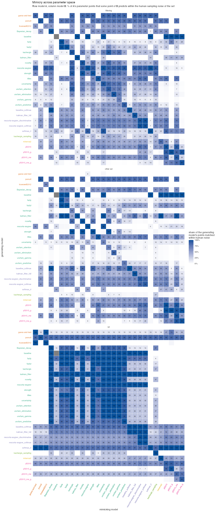
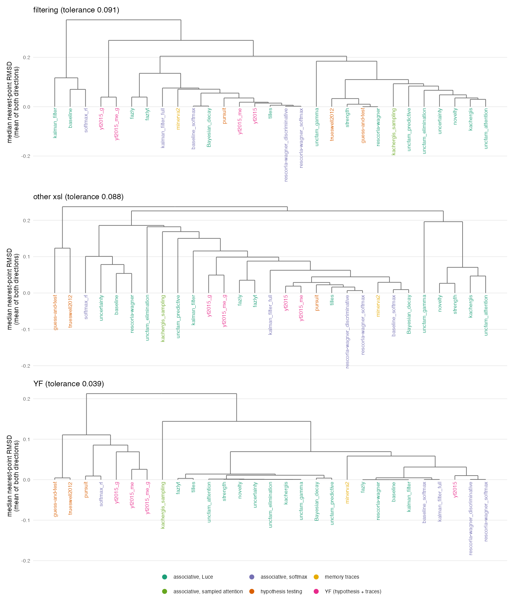
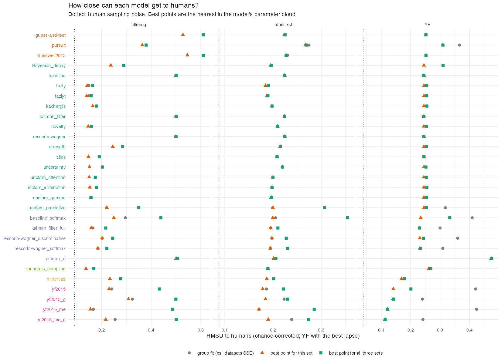
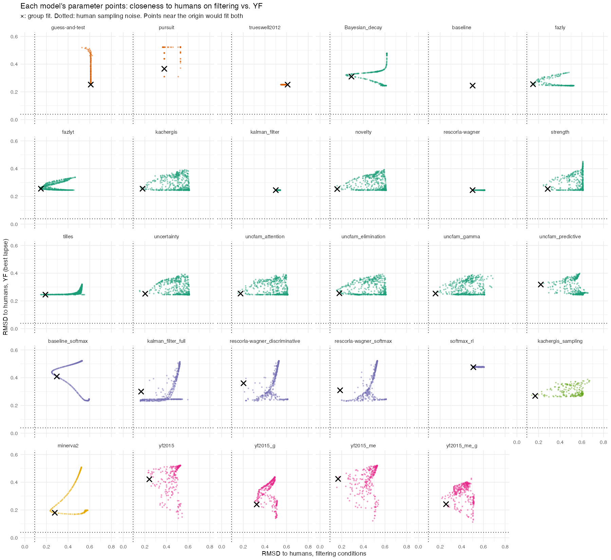
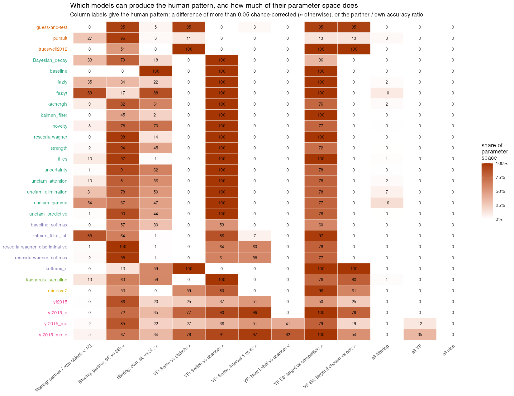

# Which models, and which experiments, cluster together?

*Stages 1 and 2: 2026-11-18, script `cluster_models.R`, output `clusters.rds`.
Stage 3: 2026-11-19, scripts `stage3_sweep.R` and `stage3_analyse.R`, output
`stage3.rds`. Figures are embedded below.*

## What was compared

**Models.** There are 29 models:
- the 25 v05 models, at their `xsl_datasets` group fits;
- the four yf2015 variants, at their v06 group fits.

**Data.**
- `xsl_datasets`: 924 test items in 47 conditions.
- Yurovsky & Frank (2015): 64 cells.
  - Exps 1–2 (48 cells): n referents × interval × Same/Switch/New Label.
  - Exp 3 (16 cells): target and familiar-competitor choices.

**Scale.** Every prediction is on a chance-corrected scale,
(p − 1/N) / (1 − 1/N). On it, 0 is chance and 1 is perfect, whatever the
number of test alternatives N.

**"baseline" is not chance.** It is a co-occurrence counter. With their group
parameters, rescorla-wagner and kalman_filter reduce to it.

**Three stages.**
- **Stage 1 (behaviour):** distances between models' predictions. On YF the
  predictions are taken without the lapse.
- **Stage 2 (fit):** residuals, model minus human. On YF the predictions
  include each model's lapse fit to Exp 1, as they were scored.
- **Stage 3 (parameter space):** stages 1–2 compare models only at their
  group-fit parameters. Stage 3 asks what each model can do anywhere in its
  parameter space, and which models can imitate which.

## Stage 1: models by behaviour

The table shows clusters from cutting the average-linkage trees at six groups.

| | xsl_datasets | YF (no lapse) |
|---|---|---|
| 1 | Co-occurrence: baseline, rescorla-wagner, kalman_filter, plus softmax_rl | Every deterministic Luce associative model (16), all nearly identical: Same = Switch = 1 |
| 2 | Hypothesis testing: trueswell2012, guess-and-test | Softmax associative models + yf2015 + yf2015_me (low accuracy everywhere) |
| 3 | pursuit (alone) | trueswell2012, guess-and-test |
| 4 | yf2015_g, yf2015_me_g | **minerva2 + humans** |
| 5 | Everything else (20 models), including minerva2, yf2015, yf2015_me, kachergis_sampling and the softmax variants | yf2015_g, yf2015_me_g |
| 6 | **Humans (alone)** | pursuit |

- **The two datasets organize the models differently.**
  - On `xsl_datasets`, most associative models are one broad family, whatever
    their choice rule. Hypothesis testers and the co-occurrence counter sit
    apart.
  - On YF, the choice rule dominates. Luce models collapse to one point,
    softmax models form another, and the models whose behaviour depends on the
    exposure response separate out: hypothesis testers, minerva2 and fixed-γ
    YF.
- **The combined tree is essentially the YF tree.** YF distances are about
  twice as large, so they dominate. Normalizing each dataset's distances
  before combining them would give a more balanced view.

- **No model is near the human noise floor on either dataset.** The floor is
  the distance a perfect model would have from human sampling noise alone:
  .089 on `xsl_datasets`, .039 on YF. The closest models are well above it:
  - on `xsl_datasets`: yf2015_me .170, fazly .178, kachergis_sampling .184,
    uncfam_gamma .185;
  - on YF: minerva2 .18, then yf2015_g and yf2015_me_g at .24.
- **Closeness on one dataset says nothing about the other.** Across models,
  the correlation between the two distances to humans is −.14. The models
  nearest humans on YF (hypothesis testers, minerva2, fixed-γ YF) are among
  the farthest on `xsl_datasets`. minerva2 is the best compromise: .23 and
  .18.

## Stage 2: experiments by how the models miss them

### What separates the models on `xsl_datasets`: the filtering conditions

This is a PCA of the predictions after removing each item's mean across
models, i.e. of what distinguishes models from each other.

**PC1 (48% of the variance) is almost entirely the 12 filtering conditions.**
- Each filtering condition carries 2.6–4.1 times its share of items.
- In the filtering test, the object that always co-occurred with the word is
  removed. Pure co-occurrence therefore scores 100%.
- One end of PC1 holds the models that ace it: co-occurrence (baseline, RW,
  KF), softmax_rl, trueswell2012 and guess-and-test.
- The other end holds the models that, like humans (about 35% correct), get
  it partly wrong: kachergis, uncfam_*, strength, kalman_filter_full, tilles.
- Humans project within that second group, next to tilles, yf2015_me,
  uncfam_gamma and rescorla-wagner_softmax.

**PC2 (17%) is mostly pursuit against the rest.** It loads on filtering again,
plus 301, 211 and the frequency conditions (2_x8, 3_x8, freq369_39mx). Humans
sit at 0, next to fazly and yf2015_me.

So in `xsl_datasets`, the filtering conditions are where most of the
model-discriminating information is. The 2xx grid, contiguity and
frequency/CD conditions separate the models much less.

### Where all the models miss together

"Shared misfit" is the median residual across models: positive when the
models collectively predict more accuracy than humans show.

**It runs against human accuracy** (r = −.53 across conditions). The models
over-predict the hard conditions (3x4 201–203, the 4AFC conditions 211–213,
1x4, filt0E) and under-predict the easy ones (1x3 215, 2x2 225, 3x4 9/12 220,
freq369_39mx).

**Even the best model only partly tracks condition difficulty.** Its
condition means correlate with humans' at r = .71 (uncfam_gamma), so the
models get the ordering of conditions only partly right.

**Some of this is not about trial structure.** Some pairs of conditions have
the same words at the same frequencies, in different orders, yet very
different human accuracy:

| Pair | Human (chance-corrected) | Model median |
|---|---|---|
| 1x3: 215 vs 222 | .73 vs .36 | .40 vs .39 |
| 3x4: 201 vs 218 | .14 vs .39 | .31 vs .33 |

215 has the same training as 211 (211 is 4AFC), where humans score .57. The
models predict the same for both conditions of each pair. Unless the trial
order explains such a large difference, this is sample or procedure variation
(lab, timing, population) that a trial-structure model can't capture. It
sets a ceiling on condition-level fit, and it's worth checking how 215 and 222
were run.

**Design features explain little of the shared misfit** (item-level R² .12):
- The only reliable predictor is the number of test alternatives, which is
  confounded with experiment family: filtering 11, 4AFC 4, others 18–24.
- Experiment family alone also explains 12%.

**Design features do explain where models disagree** (the spread of
predictions across models, R² .55). Models disagree most on items with fewer
test alternatives, fewer objects per trial, lower frequency and lower
contextual diversity. Family alone explains 54%, i.e. mostly the filtering
conditions.

### Residuals and ranks, condition by condition

**Condition clusters by residual** (rows of the bias heatmap):
1. **Filtering.** Co-occurrence and hypothesis-testing models over-predict
   strongly, especially in filt0E. The associative Luce models are close.
2. **Hard grid designs.** These are 3x4 201–203, 211–213, 1x4 221 and 3x3+1
   206. Nearly every model over-predicts.
3. **Frequency/CD, contiguity, and some grid designs.** The models are about
   right or slightly low.
4. **Easy conditions** (215, 220, 225, 216, freq369_39mx). Every model
   under-predicts.
5. **YF.**
   - Switch rows separate the associative Luce models (too high) from the
     softmax and hypothesis-testing models (too low).
   - On Same rows, everything is too low except the hypothesis testers.
   - On New Label, everything is too high except the mutual-exclusivity (ME)
     models.

**Who wins where** (the rank heatmap):

| Conditions | Best-ranked models |
|---|---|
| YF Same, YF Switch at 2–3 referents | trueswell2012, guess-and-test |
| YF Exp 3 | minerva2, yf2015_g, yf2015_me_g |
| YF New Label | yf2015_me, yf2015_me_g (the only models with ME) |
| Filtering with extra exposures (3E–9E) | fazly, kachergis, uncfam_*, kachergis_sampling |
| filt0E (no extra exposures) | the softmax variants of rescorla-wagner and kalman_filter, uncfam_predictive, yf2015_me |
| Hard grid designs (3x4 201–203, 206, 207) | baseline / RW / KF: humans are near floor, and so is co-occurrence counting |
| 4AFC 211–212 | yf2015_me, tilles, minerva2 |

The hypothesis testers are worst on filtering and the 4AFC conditions.

**Rank-based clusters of conditions don't follow the a priori families
cleanly**, except for filtering and YF. The grid, frequency/CD and contiguity
conditions intermix. What makes a condition favour one model over another
seems to be its difficulty and its test format more than its paradigm label.

## Stage 3: behaviour across parameter space

### Method

**Parameter clouds.**
- Each model is run at its group fit plus a Latin-hypercube sample of its
  fitting bounds:
  - 500 points for deterministic models;
  - 300 for the yf2015 variants;
  - 200 for models stochastic on `xsl_datasets`, each simulated with 50
    learners.
- Scale parameters are sampled on a log scale. These are parameters whose
  positive bounds span two or more orders of magnitude, such as fazly's β,
  Kalman variances, softmax φ, and uncfam's X and B. Rates and
  probabilities are sampled uniformly.
- At each point the model predicts all 924 `xsl_datasets` items and the 64
  YF cells. That's 11,429 points in total.
- The analysis splits the predictions into three sets, each on the
  chance-corrected scale:
  - **filtering**: the 12 filtering conditions, 288 items;
  - **other xsl**: the remaining 35 conditions, 636 items;
  - **YF**: the 64 cells.
- On YF a lapse multiplies the chance-corrected vector by (1 − ε). Each
  point of a model that is being imitated gets ε drawn from U(0, .5); the
  imitating model may use whatever lapse fits best.

**Mimicry.**
- Model A is the model being imitated and model B the imitator. Each point
  of A's cloud is matched to the nearest point of B's.
- B mimics that point if the match is within the set's human sampling
  noise. That noise is .091 on filtering, .088 on other xsl and .039 on YF:
  the RMSD a perfect model would show, given the sample sizes.
- The figure gives the share of A's points that B mimics.

**Signatures.**
- Nine qualitative patterns are read off the human data.
- For each model, the analysis records the share of its parameter space
  that reproduces each pattern, without a lapse. A lapse can shrink a
  difference but can't reverse it.

### What the models can do anywhere in their parameter space

The dendrograms cluster on the median nearest-point distance, averaged over
both directions.

**On YF there are three mechanisms that can't imitate each other**, whatever
their parameters.
- **Luce associative models.** These are the 16 models from stage 1, plus
  baseline, RW and KF.
  - Any model in this group reproduces essentially every point of any
    other.
  - Their YF behaviour doesn't depend on parameters. A never-seen object
    has zero strength, so Same = Switch = 1 at every point, and only the
    lapse varies.
  - No hypothesis-testing or YF model reproduces any of their points. Of
    those models' points, they reproduce only the near-chance ones.
    Every model with a lapse can reach those.
- **Hypothesis testers.** trueswell2012 and guess-and-test reproduce each
  other's points (100%).
  - yf2015_g covers 74% of guess-and-test's points.
  - Neither tester reproduces any point of the fixed-γ variants. They do
    reproduce 37–60% of yf2015's and yf2015_me's points, but those are
    the near-chance points that every model reaches.
- **YF with mutual exclusivity (ME).** Only yf2015_me reproduces
  yf2015_me_g's points (57%); no other model reproduces any of them.
- **Generic models.** The softmax associative models, softmax_rl, pursuit
  and minerva2 spend much of their parameter space at or near chance.
  - Any model with a lapse can reach those points, so these models are
    mimicked broadly.
  - minerva2 is an exception: Same > Switch > chance in much of its space.
    The YF variants and the softmax associative models reproduce 41–53% of
    its points, the Luce models 30%.

**On filtering, the clouds show which models can and can't behave like a
co-occurrence counter.**
- Some models can reproduce baseline's filtering predictions at some
  setting: kalman_filter, rescorla-wagner, softmax_rl, uncertainty and all
  four YF variants.
- fazly, kachergis, most of the uncfam family and the softmax associative
  models cannot.
- Some families are nested.
  - strength's and novelty's points are reproduced 95–99% by kachergis and
    uncfam_attention.
  - uncfam_gamma covers 74–81% of kachergis's, uncfam_attention's and
    uncfam_elimination's points. Those models cover only 32–34% of
    uncfam_gamma's.
  - So uncfam_gamma is roughly a superset of the uncfam family on
    filtering, and the same holds, less clearly, on other xsl.
- The fixed-γ YF variants behave distinctively on filtering. Apart from the
  YF variants, only the softmax RW variants reproduce a sizeable share of
  their points (45–48%); every other model reproduces at most 17%.

**On other xsl, mimicry shares are low across the board.** Treat them as
lower bounds.
- 636 items at a tolerance of .088 is a tight criterion for clouds of 200–500
  points.
- Even a model's own cloud often fails to reproduce its points. Excluding
  the point itself, the cloud reproduces 28% of uncfam_gamma's and 27% of
  kachergis_sampling's.
- Some models carry large simulation noise. With 50 learners, one
  guess-and-test run is about .20 RMSD from its expectation, so its own
  cloud reproduces only 1% of its points, and softmax_rl's reproduces none.
- Two clear results:
  - kalman_filter's points are all reproduced by fazly, fazlyt, minerva2
    and uncertainty.
  - minerva2's `xsl_datasets` behaviour is generic: other models reproduce
    50–72% of its points. Its YF behaviour is not.

### How close each model can get to humans

**On other xsl, parameters don't help.**
- Every model's best point is within .03 of its group fit (.05 for the
  fixed-γ YF variants).
- All models land at .17–.27, against a noise floor of .088.
- So stage 2's shared misfit isn't a matter of parameter values.

**On filtering, co-occurrence failure is structural for some models.**
- rescorla-wagner and kalman_filter (Luce versions) never get closer than
  .50 at any setting, the same as baseline. guess-and-test and
  trueswell2012 never get closer than .53–.55.
- The best of the rest reach .14–.16: fazly, fazlyt, kachergis_sampling,
  novelty, tilles, uncertainty, the uncfam variants, kalman_filter_full and
  yf2015_me. The floor is .091.

**On YF, only the YF variants and minerva2 get much below the Luce
plateau.**
- Best distances: yf2015_me_g .11, yf2015_me .12, yf2015 and yf2015_g .14,
  minerva2 .17.
- The softmax associative models reach .23, and every Luce model is stuck
  at .24–.25.

**There is a tradeoff inside the YF models.**
- yf2015_me's best compromise point fits YF at .12 but is .49 from humans
  on filtering.
- Its group fit, which is close to its best filtering point (.16), is .17
  on filtering and .42 on YF.
- The fixed-γ variants show the same pattern. The Luce models show no
  tradeoff, only because their YF behaviour can't change.

**minerva2 is again the best compromise.** Its best joint point (filtering
.28, other xsl .20, YF .18) is on average 3.5 noise floors from humans, root
mean square over the three sets. Next come kalman_filter_full, yf2015_me,
yf2015_me_g and rescorla-wagner_softmax, all at 4.0.

### Which human patterns each model can produce

| Pattern (human direction) | Models producing it in ≥ 50% of their parameter space |
|---|---|
| Filtering: partner-object accuracy < ½ own-object accuracy | fazlyt 89%, kalman_filter_full 85%, uncfam_gamma 54% (fazly 35%, uncfam_elimination 31%; YF variants ≤ 5%; minerva2 0) |
| YF: New Label below chance | yf2015_me_g 82% (yf2015_me 41%; **no other model, anywhere**) |
| YF: Same falls with the interval | yf2015_g/_me_g 96–97%, yf2015/_me 51%, RW softmax variants 58–60% |
| YF: Same > Switch | trueswell2012, softmax_rl 100%, guess-and-test 95%, yf2015_g/_me_g 77–78%, minerva2 59% (no Luce model) |
| YF: Switch above chance | every Luce model and kachergis_sampling 100%, yf2015_g/_me_g 90–91%, kalman_filter_full 86%, minerva2 80% (no hypothesis tester) |

- **No model produces all nine human patterns at any sampled point.**
- **All six YF patterns** occur only in yf2015_me_g (35% of its space) and
  yf2015_me (12%).
- **All three filtering patterns** occur in at most 16% of a model's space:
  uncfam_gamma 16%, fazlyt 10%, uncfam_elimination 7%. The YF variants have
  none.
- So the mechanism that gives YF's pattern and the mechanism that gives
  filtering's are, in this model set, never in the same model:
  - **YF** needs graded memory for the chosen referent, plus mutual
    exclusivity for New Label.
  - **Filtering** needs learning that keeps a partner's co-occurrence from
    becoming a mapping once the word's own referent is known.
- Neither pattern is a matter of parameter tuning. The models that can't
  produce one can't do so anywhere in their bounds.

### Caveats

- **Shares depend on the sampling distribution** (log versus uniform
  scales) and on cloud density. Where a model's own cloud reproduces only
  part of its points, read the shares as lower bounds.
- **Noisy models.** Simulation noise inflates the distances of the noisiest
  stochastic models on `xsl_datasets` (guess-and-test, minerva2,
  trueswell2012, kachergis_sampling). The noise varies by orders of
  magnitude across a model's parameter space, so no single correction is
  subtracted.
- **YF noise.** On YF, the scoring conditions on each learner's own choice
  and the design is symmetric over objects. So most stochastic models give
  the same YF predictions for every simulated learner.
- **Thresholds.** The signature thresholds (a .05 chance-corrected
  difference, a ratio of ½) are judgment calls; the figure shows the shares
  they produce.
- **yf2015 modes.** The yf2015 variants run in mean-field mode on
  `xsl_datasets` and in sampling mode on YF, as in stages 1–2.

## Takeaways

1. **The datasets probe different things.**
   - `xsl_datasets` mainly separates models by whether they fall for the
     filtering test, i.e. pure co-occurrence versus competitive or
     attention-weighted learning.
   - YF separates them by whether behaviour depends on the learner's own
     earlier response.
   - These two dimensions are nearly independent across models. Fitting one
     dataset says little about the other.
2. **minerva2 is the model closest to humans on both datasets together.**
   Every other model is close on one and far on the other.
3. **A large share of the misfit is shared by all models** and tracks
   condition difficulty. Part of it is human variation between conditions
   with the same structure (215 vs 222, 201 vs 218). It should be treated as
   a ceiling, or modelled with condition-level parameters, rather than chased
   with new learning mechanisms.
4. **The split is mechanistic, not a fitting accident** (stage 3).
   - Across their whole parameter spaces, no model produces both the YF
     pattern and the filtering pattern.
   - The models that can produce YF's pattern can't produce filtering's,
     and vice versa.
   - Within the YF variants, the points that fit one dataset are far from
     humans on the other.
   - A model that adds competitive or attention-limited association to
     YF-style hypothesis memory and mutual exclusivity is the obvious
     candidate.
5. **Next steps.**
   - **Combine the mechanisms.** Test a hybrid that adds YF-style
     hypothesis memory and mutual exclusivity to uncfam_gamma or fazlyt,
     the models that produce the filtering pattern most often.
   - **Same-design pairs.** Check how 215/222 and 201/218 were run before
     reading much into condition-level residuals. Stage 3 shows the
     other-xsl misfit doesn't shrink at any parameter setting.
