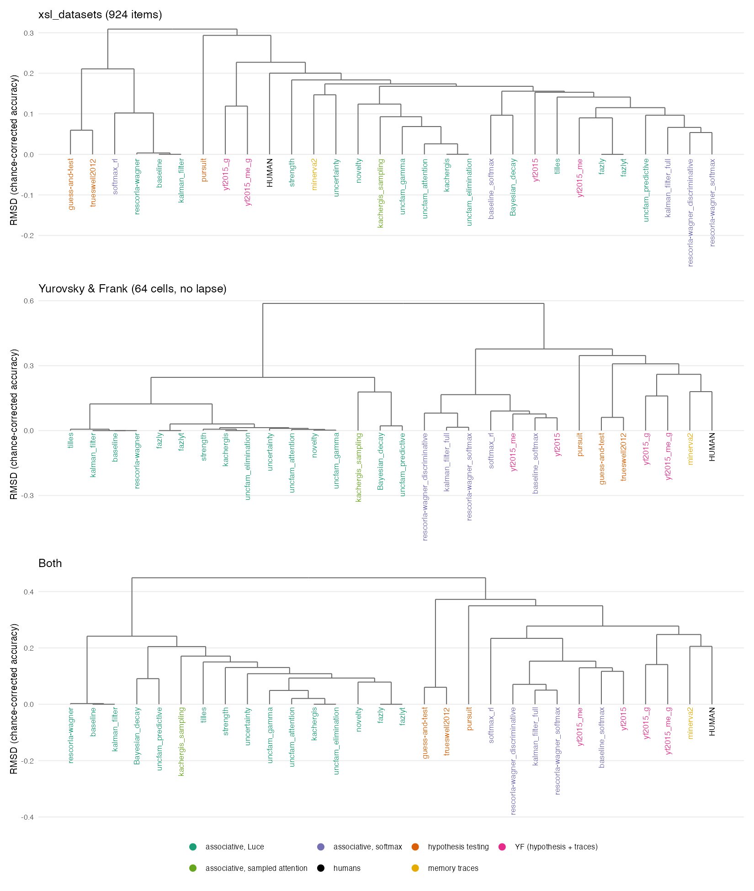
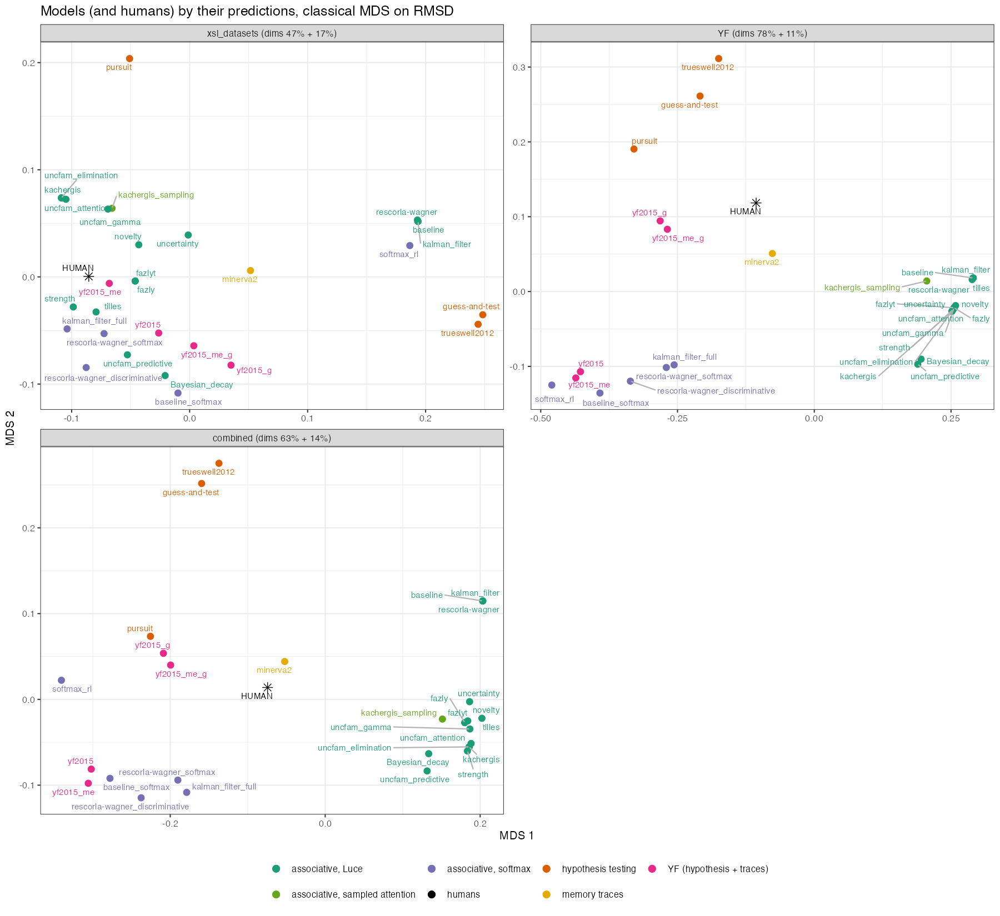
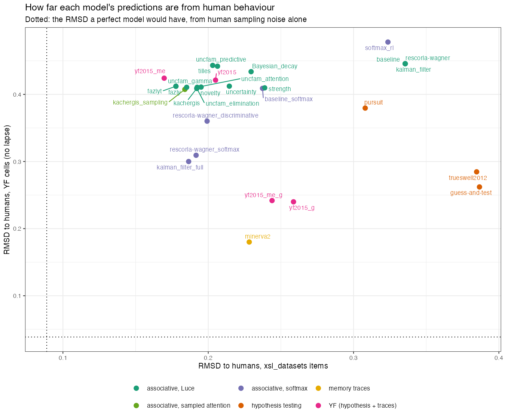
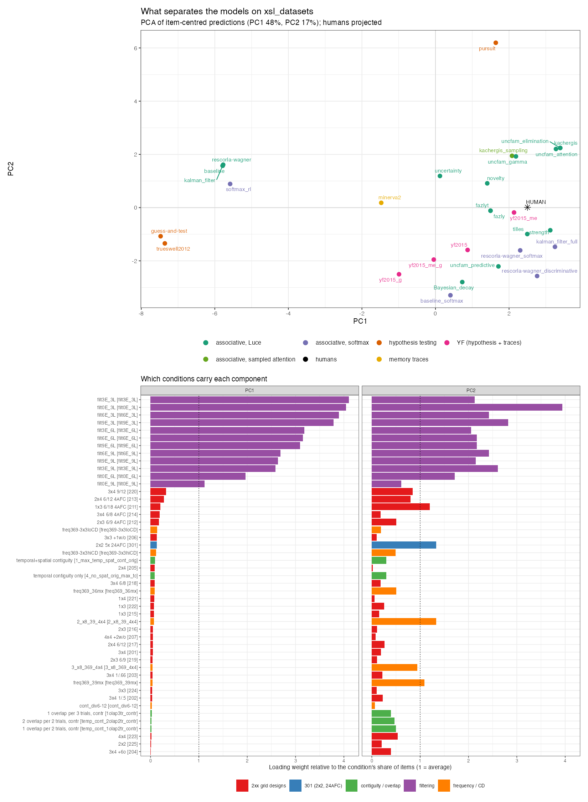

# Which models, and which experiments, cluster together?

*Stages 1 and 2. 2026-11-18. Script: `cluster_models.R`. Output: `clusters.rds`
and the figures below.*

## What was compared

**Models.** There are 29 models:
- the 25 v05 models, at their `xsl_datasets` group fits;
- the four yf2015 variants, at their v06 group fits.

**Data.**
- `xsl_datasets`: 924 test items in 47 conditions.
- Yurovsky & Frank (2015): 64 cells.
  - Exps 1–2 (48 cells): n referents × interval × Same/Switch/New Label.
  - Exp 3 (16 cells): target and familiar-competitor choices.

**Scale.** Every prediction is on a chance-corrected scale,
(p − 1/N) / (1 − 1/N). On it, 0 is chance and 1 is perfect, whatever the
number of test alternatives N.

**"baseline" is not chance.** It is a co-occurrence counter. With their group
parameters, rescorla-wagner and kalman_filter reduce to it.

**Two stages.**
- **Stage 1 (behaviour):** distances between models' predictions. On YF the
  predictions are taken without the lapse.
- **Stage 2 (fit):** residuals, model minus human. On YF the predictions
  include each model's lapse fit to Exp 1, as they were scored.

## Stage 1: models by behaviour

The table shows clusters from cutting the average-linkage trees at six groups.

| | xsl_datasets | YF (no lapse) |
|---|---|---|
| 1 | Co-occurrence: baseline, rescorla-wagner, kalman_filter, plus softmax_rl | Every deterministic Luce associative model (16), all nearly identical: Same = Switch = 1 |
| 2 | Hypothesis testing: trueswell2012, guess-and-test | Softmax associative models + yf2015 + yf2015_me (low accuracy everywhere) |
| 3 | pursuit (alone) | trueswell2012, guess-and-test |
| 4 | yf2015_g, yf2015_me_g | **minerva2 + humans** |
| 5 | Everything else (20 models), including minerva2, yf2015, yf2015_me, kachergis_sampling and the softmax variants | yf2015_g, yf2015_me_g |
| 6 | **Humans (alone)** | pursuit |

- **The two datasets organize the models differently.**
  - On `xsl_datasets`, most associative models are one broad family, whatever
    their choice rule. Hypothesis testers and the co-occurrence counter sit
    apart.
  - On YF, the choice rule dominates. Luce models collapse to one point,
    softmax models form another, and the models whose behaviour depends on the
    exposure response separate out: hypothesis testers, minerva2 and fixed-γ
    YF.
- **The combined tree is essentially the YF tree.** YF distances are about
  twice as large, so they dominate. Normalizing each dataset's distances
  before combining them would give a more balanced view.

- **No model is near the human noise floor on either dataset.** The floor is
  the distance a perfect model would have from human sampling noise alone:
  .089 on `xsl_datasets`, .039 on YF. The closest models are well above it:
  - on `xsl_datasets`: yf2015_me .170, fazly .178, kachergis_sampling .184,
    uncfam_gamma .185;
  - on YF: minerva2 .18, then yf2015_g and yf2015_me_g at .24.
- **Closeness on one dataset says nothing about the other.** Across models,
  the correlation between the two distances to humans is −.14. The models
  nearest humans on YF (hypothesis testers, minerva2, fixed-γ YF) are among
  the farthest on `xsl_datasets`. minerva2 is the best compromise: .23 and
  .18.

## Stage 2: experiments by how the models miss them

### What separates the models on `xsl_datasets`: the filtering conditions

This is a PCA of the predictions after removing each item's mean across
models, i.e. of what distinguishes models from each other.

**PC1 (48% of the variance) is almost entirely the 12 filtering conditions.**
- Each filtering condition carries 2.6–4.1 times its share of items.
- In the filtering test, the object that always co-occurred with the word is
  removed. Pure co-occurrence therefore scores 100%.
- One end of PC1 holds the models that ace it: co-occurrence (baseline, RW,
  KF), softmax_rl, trueswell2012 and guess-and-test.
- The other end holds the models that, like humans (about 35% correct), get
  it partly wrong: kachergis, uncfam_*, strength, kalman_filter_full, tilles.
- Humans project within that second group, next to tilles, yf2015_me,
  uncfam_gamma and rescorla-wagner_softmax.

**PC2 (17%) is mostly pursuit against the rest.** It loads on filtering again,
plus 301, 211 and the frequency conditions (2_x8, 3_x8, freq369_39mx). Humans
sit at 0, next to fazly and yf2015_me.

So in `xsl_datasets`, the filtering conditions are where most of the
model-discriminating information is. The 2xx grid, contiguity and
frequency/CD conditions separate the models much less.

### Where all the models miss together

"Shared misfit" is the median residual across models: positive when the
models collectively predict more accuracy than humans show.

**It runs against human accuracy** (r = −.53 across conditions). The models
over-predict the hard conditions (3x4 201–203, the 4AFC conditions 211–213,
1x4, filt0E) and under-predict the easy ones (1x3 215, 2x2 225, 3x4 9/12 220,
freq369_39mx).

**Even the best model only partly tracks condition difficulty.** Its
condition means correlate with humans' at r = .71 (uncfam_gamma), so the
models get the ordering of conditions only partly right.

**Some of this is not about trial structure.** Some pairs of conditions have
the same words at the same frequencies, in different orders, yet very
different human accuracy:

| Pair | Human (chance-corrected) | Model median |
|---|---|---|
| 1x3: 215 vs 222 | .73 vs .36 | .40 vs .39 |
| 3x4: 201 vs 218 | .14 vs .39 | .31 vs .33 |

215 has the same training as 211 (211 is 4AFC), where humans score .57. The
models predict the same for both conditions of each pair. Unless the trial
order explains such a large difference, this is sample or procedure variation
(lab, timing, population) that a trial-structure model can't capture. It
sets a ceiling on condition-level fit, and it's worth checking how 215 and 222
were run.

**Design features explain little of the shared misfit** (item-level R² .12):
- The only reliable predictor is the number of test alternatives, which is
  confounded with experiment family: filtering 11, 4AFC 4, others 18–24.
- Experiment family alone also explains 12%.

**Design features do explain where models disagree** (the spread of
predictions across models, R² .55). Models disagree most on items with fewer
test alternatives, fewer objects per trial, lower frequency and lower
contextual diversity. Family alone explains 54%, i.e. mostly the filtering
conditions.

### Residuals and ranks, condition by condition

**Condition clusters by residual** (rows of the bias heatmap):
1. **Filtering.** Co-occurrence and hypothesis-testing models over-predict
   strongly, especially in filt0E. The associative Luce models are close.
2. **Hard grid designs.** These are 3x4 201–203, 211–213, 1x4 221 and 3x3+1
   206. Nearly every model over-predicts.
3. **Frequency/CD, contiguity, and some grid designs.** The models are about
   right or slightly low.
4. **Easy conditions** (215, 220, 225, 216, freq369_39mx). Every model
   under-predicts.
5. **YF.**
   - Switch rows separate the associative Luce models (too high) from the
     softmax and hypothesis-testing models (too low).
   - On Same rows, everything is too low except the hypothesis testers.
   - On New Label, everything is too high except the mutual-exclusivity (ME)
     models.

**Who wins where** (the rank heatmap):

| Conditions | Best-ranked models |
|---|---|
| YF Same, YF Switch at 2–3 referents | trueswell2012, guess-and-test |
| YF Exp 3 | minerva2, yf2015_g, yf2015_me_g |
| YF New Label | yf2015_me, yf2015_me_g (the only models with ME) |
| Filtering with extra exposures (3E–9E) | fazly, kachergis, uncfam_*, kachergis_sampling |
| filt0E (no extra exposures) | the softmax variants of rescorla-wagner and kalman_filter, uncfam_predictive, yf2015_me |
| Hard grid designs (3x4 201–203, 206, 207) | baseline / RW / KF: humans are near floor, and so is co-occurrence counting |
| 4AFC 211–212 | yf2015_me, tilles, minerva2 |

The hypothesis testers are worst on filtering and the 4AFC conditions.

**Rank-based clusters of conditions don't follow the a priori families
cleanly**, except for filtering and YF. The grid, frequency/CD and contiguity
conditions intermix. What makes a condition favour one model over another
seems to be its difficulty and its test format more than its paradigm label.

## Takeaways

1. **The datasets probe different things.**
   - `xsl_datasets` mainly separates models by whether they fall for the
     filtering test, i.e. pure co-occurrence versus competitive or
     attention-weighted learning.
   - YF separates them by whether behaviour depends on the learner's own
     earlier response.
   - These two dimensions are nearly independent across models. Fitting one
     dataset says little about the other.
2. **minerva2 is the model closest to humans on both datasets together.**
   Every other model is close on one and far on the other.
3. **A large share of the misfit is shared by all models** and tracks
   condition difficulty. Part of it is human variation between conditions
   with the same structure (215 vs 222, 201 vs 218). It should be treated as
   a ceiling, or modelled with condition-level parameters, rather than chased
   with new learning mechanisms.
4. **Next steps.**
   - **Stage 3 (parameter-space mimicry)** would be most informative on the
     filtering and YF conditions: they carry most of the between-model
     variance.
   - **Same-design pairs:** check how 215/222 and 201/218 were run before
     reading much into condition-level residuals.
