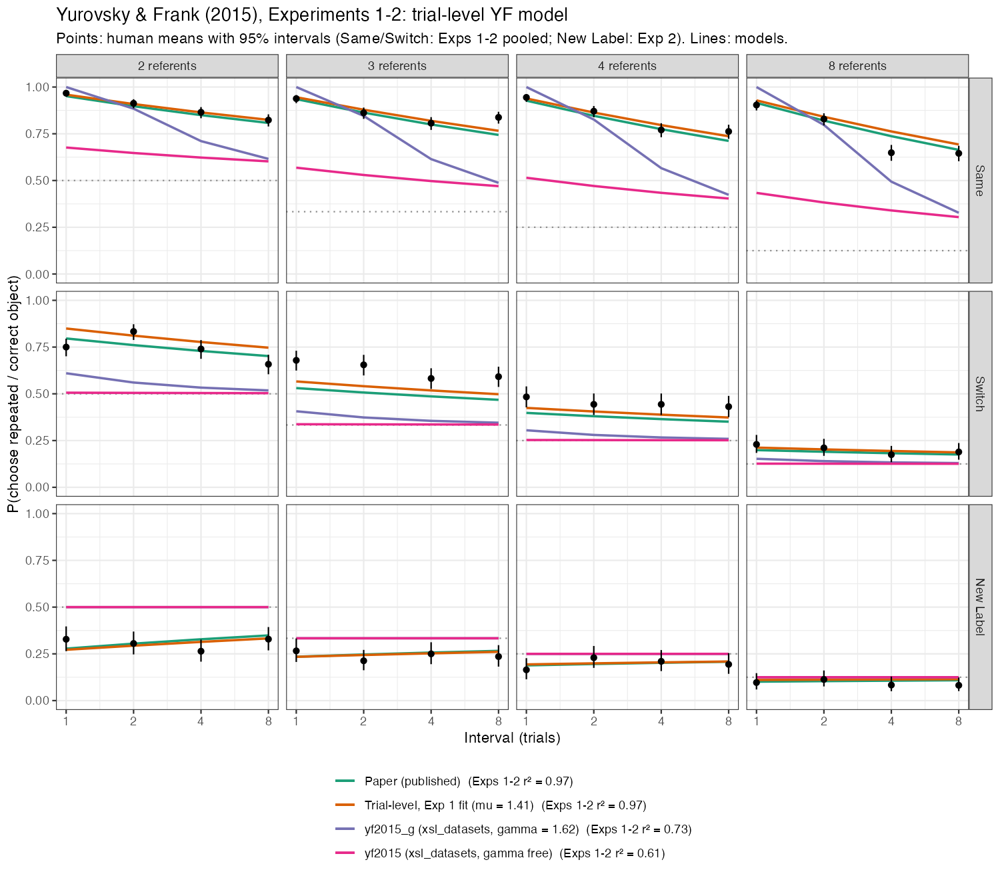
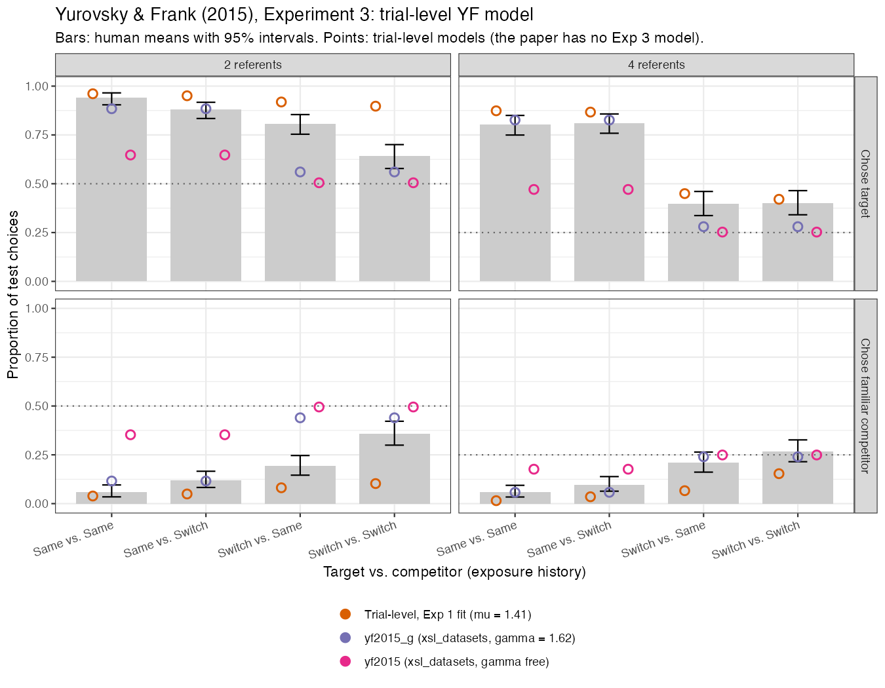
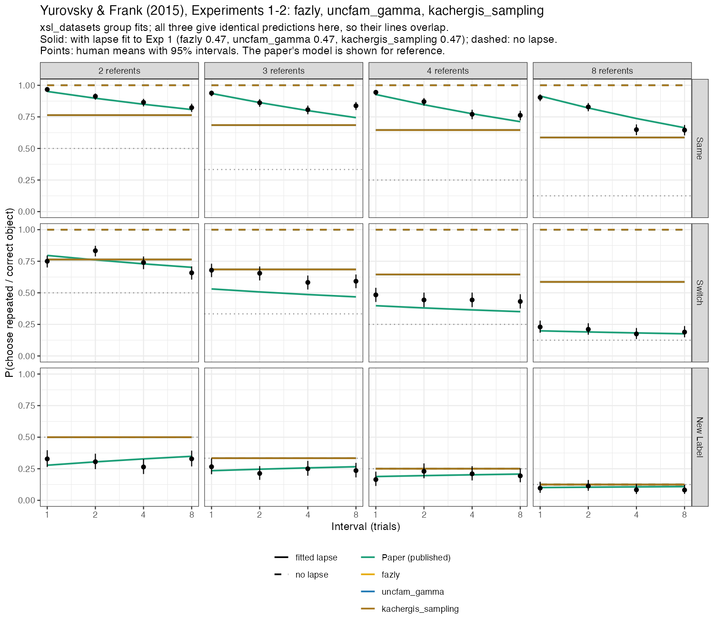
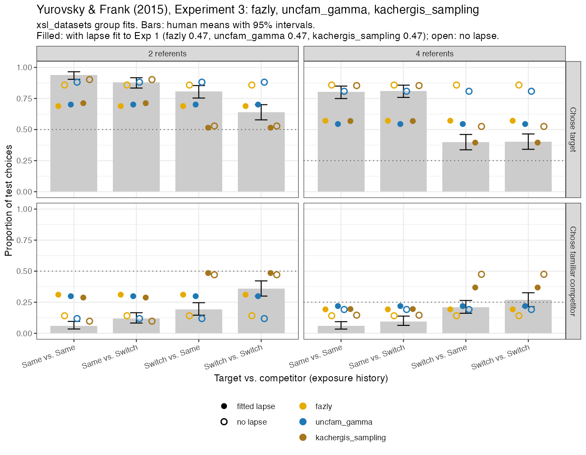

# Models on Yurovsky & Frank (2015)

*Summary as of 2026-11-18. Everything here is on xsl-bakeoff branch
`v06-refit`. It uses XSLmodels at 49d9d61, branch `add-yurovsky-frank2015`
(PR #46, not merged yet).*

Yurovsky, D., & Frank, M. C. (2015). An integrative account of constraints on
cross-situational learning. *Cognition*, 145, 53–62.

## Short version

**The trial-level YF model reproduces the paper's model.**
- `yf2015()` is a trial-by-trial version of the paper's Integrated model.
- At the paper's parameters, it gives the same Same and Switch predictions to
  1e-16.
- For New Label trials it uses a mutual-exclusivity strength μ in place of the
  paper's undocumented rule. With μ = 1.41 it fits Exps 1–2 as well as the
  paper does: r² .975 against .970.

**No bake-off model fit to `xsl_datasets` predicts the YF data as well.**
- The paper's model, fit to Exp 1, scores −1444 on held-out log-likelihood
  (Exps 2–3). Chance scores −4143.
- The best generalizing models are:

  | Model | Held-out loglik |
  |---|---|
  | trueswell2012 (propose-but-verify) | −1564 |
  | guess-and-test | −1565 |
  | minerva2 | −1683 |
  | yf2015 with γ fixed at the paper's value | −1721 |

**The models that fit `xsl_datasets` best transfer poorly.** That includes
yf2015_me, fazly, uncfam_gamma and kachergis_sampling.
- Deterministic associative models predict Same = Switch = 1 at every interval
  and number of referents. After one exposure, the word's strength is spread
  evenly over its objects. At test, every alternative but the seen object is
  novel, so a Luce rule always picks the seen object.
- They need a lapse rate of about .47 to reach a reasonable likelihood.
- Even then they predict no Same–Switch difference and no decay over the
  interval.

**`xsl_datasets` and the YF experiments want different YF parameters.**
- Fit freely to `xsl_datasets`, the YF model settles on weak encoding:
  γ ≈ .3, against 1.6 in the paper.
- Fixing γ at 1.62 rescues the transfer: held-out loglik goes from −3096 to
  −1721. But it worsens CV SSE on `xsl_datasets` from .64 to .98, because the
  fit compensates with fast decay (λ ≈ .87).
- End-of-training tests can't separate encoding strength from decay. The YF
  interval manipulation can.

## Data and paradigm

The dataset is `yurovsky_frank2015` in XSLmodels, copied from
[dyurovsky/XSIT-MIN](https://github.com/dyurovsky/XSIT-MIN) at fb44199.

| Experiment | Participants | Conditions | Trial types |
|---|---|---|---|
| Exp 1 | 1196 | 2/3/4/8 referents × interval 1/2/4/8, between subjects | Same, Switch |
| Exp 2 | 803 | the same conditions | Same, Switch, New Label |
| Exp 3 | 465 | 2 or 4 referents | Two words per block. Target and familiar competitor are each Same or Switch. |

Exp 3's 465 includes 8 workers who took part in both conditions.

The paradigm is response-contingent:
- A word's test shows the object the participant chose on its exposure trial
  (Same) or one they didn't choose (Switch).
- In Exp 2's New Label trials, the test shows an object they didn't choose,
  with a new word.
- In Exp 3, the test pits word A's target against an object from word B's
  exposure.

## How the models are evaluated

**1. Fit to the YF data** (the paper's approach). Closed-form models are fit to
Exp 1 by maximum likelihood (`yf2015_fit()`), then predict Exp 2.

**2. Generalization from `xsl_datasets`.** Every bake-off model's group fit to
the 47 `xsl_datasets` conditions predicts all three experiments, with no
refitting. The fits use v05's procedure: n_subj-weighted SSE, DEoptim, best of
3 restarts, 5-fold CV.

What counts as the model's exposure-trial response?
- **`score_yf_all.R`** (used for all models): the response is the model's own
  choice among the trial's objects, right after the trial. Same/Switch/New
  Label are conditioned on it, per simulated learner.
- **`yf2015_paradigm()`** (the YF models only): the response is the learner's
  sampled hypothesis.
- For yf2015 the two methods differ slightly. This is why yf2015_g's
  Exps 1–2 r² is .75 in the all-model table and .73 in the plots.

**Lapse.** Each model gets one lapse rate: the probability of a uniform guess.
It is fit to Exp 1, so Exps 2–3 stay held out.

**Training sequences** follow each experiment's fixed design, without the 4
practice trials. The paper doesn't give Exp 3's block order, so blocks are run
in sequence.

## 1. The paper's models (reproduction)

The XSIT-MIN Stan fits reproduce Table 3 exactly. They do so only because the
condition indices are transposed: the 2-referent, interval-8 data are scored as
8-referent, interval-1, and so on. Fixing the index barely changes the r²s and
the ranking, but it does change the likelihoods and parameters. Maximum
likelihood on Exp 1 with correct indexing:

| Model | Max loglik | BIC | Exp 1 r² | Exps 1–2 r² | Parameters |
|---|---|---|---|---|---|
| Statistical Accumulation | −4157.2 | 8329.9 | .32 | .67 | λ = .101, γ = 1.769 |
| Single Referent | −3560.2 | 7136.0 | .83 | .77 | λ = .172, γ = .920 |
| **Integrated** | **−3085.5** | **6194.2** | **.95** | **.98** | σ = .568, λ = .167, γ = 1.617 |

The paper's published posterior means come from the transposed fit: σ = .604,
λ = .184, γ = 1.495. Two other problems:
- The New Label prediction uses an undocumented rule: Switch strength / 4,
  subtracted from chance.
- Table 3's "log likelihood" is the mean Stan `lp__`.

See `data-raw/YurovskyFrank2015/PROVENANCE.md` in XSLmodels for details.

## 2. The trial-level model, `yf2015()`

`yf2015()` generalizes the Integrated model to any training sequence:
- **Traces.** Timestamped traces decay as a power law.
- **Encoding.** On each exposure, γσ goes to the hypothesized object and
  γ(1−σ)/(n−1) to each other object.
- **Choice.** Choices follow a remember-or-guess rule: the paper's Eq. 5,
  becoming Luce choice when total strength exceeds 1.
- **Guessing.** Guesses avoid objects already associated with other words,
  with strength μ.
- **Fitting mode.** `sampling = FALSE` is a deterministic mean-field version,
  used for fitting.

**Agreement with the paper.** At the paper's parameters, `yf2015_paradigm()`
equals the closed form on every Same and Switch condition: the largest
difference is 1.1e-16.

**Mutual exclusivity**, with σ, λ and γ held at the Exp 1 estimates:

| Data | Best μ | Result |
|---|---|---|
| Exp 2 (New Label) | 1.41 | NLL 49.8, against 136.6 at μ = 0 (chance) and 51.8 for the paper's rule; r .94 against .92 |
| Exp 3 | 0 | ME can't help here |

Why μ can't help in Exp 3:
- People do avoid a competitor they had hypothesized for the other word more
  than one they hadn't.
- But they choose familiar competitors more often overall than the model
  predicts. At 2 referents with a Switch target, people choose the competitor
  .36 of the time; the model predicts .10 at μ = 1.41.
- ME can only push choices away from familiar objects, never toward them.

| Model (Exps 1–2, `yf2015_paradigm()`) | r² | RMSE |
|---|---|---|
| Paper's model (published parameters) | .970 | .054 |
| Trial-level, Exp 1 fit, μ = 1.41 | .975 | .047 |
| yf2015_g (`xsl_datasets` fit, γ = 1.62) | .73 | .16 |
| yf2015 (`xsl_datasets` fit, γ free) | .61 | .25 |

The paper has no Exp 3 model. In Exp 3 the trial-level Exp 1 fit does well
when the target was the learner's earlier hypothesis. At 2 referents it
overpredicts the target when the target was a Switch object: .90, against .64
for people.

## 3. The YF model fit to `xsl_datasets`

There are four variants (`specs_yf2015.R`), all fit in mean-field mode. "Rank"
is among the 27 bake-off models by CV SSE. The parameter columns are group-fit
values, with the range over CV folds in brackets.

| Variant | Free parameters | Group SSE | CV SSE (rank) | σ | λ | γ | μ |
|---|---|---|---|---|---|---|---|
| yf2015_me | σ, λ, γ, μ | .430 | **.456 (1st)** | .926 [.91–.96] | .237 [.17–.27] | .255 [.23–.28] | 3.52 [2.86–4.51] |
| yf2015 | σ, λ, γ | .626 | .639 (12th) | .967 [.95–.99] | .261 [.22–.29] | .365 [.33–.39] | – |
| yf2015_me_g | σ, λ, μ | .874 | .913 (19th) | .848 [.80–.88] | 1.02 [.96–1.05] | 1.62 (fixed) | 2.48 [1.86–2.98] |
| yf2015_g | σ, λ | .969 | .979 (21st) | .864 [.85–.88] | .866 [.86–.88] | 1.62 (fixed) | – |

yf2015_me is the best model in the bake-off on `xsl_datasets`, ahead of fazly
(.483). In every variant, σ is near 1, so the learner mostly tracks a single
referent.

**Transfer to YF**, via `yf2015_paradigm()` with no refitting:

| Model | Exp 1 r² | Exps 1–2 r² | Exps 1–2 loglik | Exp 3 r (target) | Exp 3 r (competitor) | Exp 3 loglik |
|---|---|---|---|---|---|---|
| yf2015 | .86 | .63 | −3014 | .93 | .51 | −1505 |
| yf2015_me | .72 | .50 | −3798 | .82 | .56 | −1488 |
| yf2015_g | .81 | .74 | −3227 | .94 | .82 | −1276 |
| yf2015_me_g | .77 | .72 | −3476 | .96 | .81 | −1446 |
| *Reference: Integrated fit to Exp 1* | *.95* | *.95* | *−364* | *.96* | *.84* | *−1247* |

- **Free γ.** The pattern transfers (Exp 1 r² .86) but the levels don't. With
  γ ≈ .3, Same accuracy is far too low and Switch is at chance.
- **Fixed γ.** Accuracy starts at the right level. But the fit's fast decay
  makes Same accuracy fall too steeply over the interval.

## 4. All bake-off models on YF

Models are scored by `score_yf_all.R`, each with its fitted lapse. "Exp 1
loglik" is in-sample for the lapse. "Held-out" is Exp 2 plus Exp 3.
"Same − Switch" is the mean predicted difference in Exps 1–2. The table is
sorted by held-out log-likelihood.

| Model | CV SSE (xsl) | Lapse | Exp 1 loglik | Held-out loglik | Exps 1–2 r² | Same − Switch | Exp 3 r (target) | Exp 3 r (competitor) |
|---|---|---|---|---|---|---|---|---|
| *Integrated, fit to Exp 1 (μ = 0)* | – | – | *−166 (fit)* | ***−1444*** | – | – | – | – |
| trueswell2012 | 2.065 | .22 | −736 | **−1564** | .79 | .54 | .92 | .81 |
| guess-and-test | 2.088 | .13 | −737 | −1565 | .79 | .54 | .92 | .81 |
| minerva2 | .802 | .00 | −557 | −1683 | .75 | .16 | .93 | .84 |
| yf2015_g | .979 | .00 | −865 | −1721 | .75 | .31 | .97 | .80 |
| tilles | .632 | .47 | −1081 | −1791 | .65 | .00 | .54 | .12 |
| baseline | – | .47 | −1081 | −1791 | .65 | .00 | .54 | .12 |
| kalman_filter | 1.628 | .47 | −1081 | −1791 | .65 | .00 | .54 | .12 |
| rescorla-wagner | 1.633 | .47 | −1081 | −1791 | .65 | .00 | .54 | .12 |
| uncertainty | .730 | .47 | −1081 | −1816 | .65 | .00 | .54 | .12 |
| fazly | .483 | .47 | −1081 | −1820 | .65 | .00 | .54 | .12 |
| fazlyt | – | .47 | −1081 | −1820 | .65 | .00 | .54 | .12 |
| novelty | .638 | .47 | −1081 | −1820 | .65 | .00 | .54 | .12 |
| uncfam_gamma | .524 | .47 | −1081 | −1821 | .65 | .00 | .54 | .12 |
| uncfam_attention | .585 | .47 | −1081 | −1822 | .65 | .00 | .54 | .12 |
| strength | .957 | .47 | −1081 | −1825 | .65 | .00 | .54 | .12 |
| uncfam_elimination | .587 | .47 | −1081 | −1829 | .65 | .00 | .54 | .12 |
| kachergis | .587 | .47 | −1081 | −1829 | .65 | .00 | .54 | .12 |
| kachergis_sampling | .530 | .47 | −1081 | −1848 | .65 | .00 | .92 | .82 |
| yf2015_me_g | .913 | .00 | −1072 | −1874 | .75 | .27 | .93 | .81 |
| Bayesian_decay | .830 | .47 | −1081 | −1990 | .65 | .00 | .54 | .12 |
| uncfam_predictive | .702 | .47 | −1081 | −2012 | .65 | .00 | .54 | .12 |
| kalman_filter_full | .571 | .00 | −1631 | −2465 | .43 | .00 | .54 | .12 |
| rescorla-wagner_softmax | .608 | .00 | −1720 | −2531 | .41 | .00 | .54 | .12 |
| rescorla-wagner_discriminative | .653 | .00 | −2211 | −2882 | .33 | .00 | .54 | .12 |
| pursuit | 1.490 | .18 | −2863 | −2970 | .28 | .24 | .92 | .82 |
| yf2015 | .639 | .00 | −2663 | −3096 | .36 | .07 | .73 | .28 |
| baseline_softmax | .889 | .00 | −2726 | −3233 | .25 | .00 | .54 | .12 |
| yf2015_me | .456 | .00 | −3164 | −3330 | .31 | .03 | .62 | .27 |
| softmax_rl | 1.469 | .00 | −3418 | −3541 | .21 | .05 | .76 | .30 |
| *Chance* | – | – | *−4116* | *−4143* | – | – | – | – |

The Integrated and chance rows use `yf2015_paradigm()` rather than the
scorer. baseline and fazlyt have no CV SSE in the v05 summary.

**How the models group.**

1. **Hypothesis-testing models: trueswell2012 and guess-and-test.**
   - They generalize best, despite the worst `xsl_datasets` fits (CV SSE
     about 2.1).
   - Committing to one referent gives them a large Same–Switch difference:
     .54 predicted at every set size. In the data it averages .33, rising
     from .15 at 2 referents to .56 at 8.
   - They don't decay over the interval.
2. **minerva2 and yf2015_g.** These two predict a Same–Switch difference, an
   effect of the interval, and Exp 3's competitor pattern, with no lapse.
3. **Deterministic Luce associative models.**
   - These are fazly, uncfam_*, kachergis, tilles, novelty, strength,
     uncertainty, Rescorla-Wagner, the Kalman filter and Bayesian_decay.
   - Without a lapse, they predict Same = Switch = 1, and New Label at
     chance.
   - All fit the same lapse (.47) and the same Exps 1–2 predictions. They
     differ only on Exp 3.
4. **kachergis_sampling.** It belongs to group 3 on Exps 1–2. On Exp 3, its
   stochastic attention gives Same/Switch target differences and the
   familiar-competitor pull (r .92 and .82).
5. **Softmax-choice models.**
   - These are the RW/KF softmax variants, baseline_softmax and softmax_rl.
     Their fitted lapse is 0.
   - Their sharp choice rules can't recover from confident wrong predictions,
     so they generalize worst: below −2400.
   - pursuit fits a .18 lapse but still scores below −2900.

On Exps 1–2, fazly, uncfam_gamma and kachergis_sampling predict the same
thing, so their lines overlap. With the lapse they give flat lines just above
chance (r² .65). They miss both the decline over the interval and the
Same–Switch gap.

On Exp 3, pooling target and competitor choices, the correlations are fazly
.88, uncfam_gamma .89 and kachergis_sampling .91 (with the lapse).
- fazly and uncfam_gamma predict the same for all four target/competitor
  conditions, because deterministic models don't depend on the exposure
  response.
- kachergis_sampling separates Same from Switch targets, and at 4 referents it
  lands close to people.

## Takeaways

1. **Ranking on `xsl_datasets` doesn't predict ranking on YF.** Across the 27
   models, the rank correlation between fit quality on `xsl_datasets` (CV
   SSE) and on YF (held-out log-likelihood) is −.28: slightly negative. The
   two best transfer models have the worst `xsl_datasets` fits.
2. **YF needs response-contingent state.** Its key signature is Same > Switch,
   with Switch still above chance at small referent sets. Only models whose
   state depends on the exposure response can produce it: hypothesis
   testing (trueswell2012, guess-and-test), stochastic encoding or attention
   (minerva2, kachergis_sampling), or a sampled hypothesis plus distributed
   encoding as in yf2015.
3. **Encoding strength and decay trade off.** `xsl_datasets` can't separate
   them, but YF's interval manipulation can. The YF parameters that fit both
   datasets well differ, so a joint fit (or adding YF as a fitting target)
   would be informative. It would be costly to iterate, though, because trial
   order depends on choices.
4. **Exp 3 shows a pull toward familiar competitors** that no model with ME
   captures. kachergis_sampling, minerva2 and yf2015_g come closest.

## Caveats and open items

- **License.** XSIT-MIN has no license file, so we need Dan's or Mike's OK
  before releasing the data in XSLmodels.
- **Unmerged code.** These results use XSLmodels at 49d9d61. PR #46 is not
  merged.
- **Exp 3 block order.** It is an assumption: blocks are run in sequence, with
  one Ex-B between each Ex-A and T-A.
- **μ = 1.41** is fit to Exp 2, so it is not held out for Exp 2.
- **New Label for other models.** It is modelled as Switch with a novel word.
  Deterministic associative models therefore predict chance.

## Files (`fits/v06/yf2015/`)

| File | Contents |
|---|---|
| `specs_yf2015.R` | The four YF variants (γ fixed at `PAPER_GAMMA` = 1.62) |
| `refit_yf2015.R` | Group fits and CV; outputs `yf2015_fits.Rdata` and `yf2015_refit_summary.rds` |
| `generalize_yf.R` | YF-model transfer via `yf2015_paradigm()`; outputs `generalization_yf.rds` |
| `score_yf_all.R` | All-model scoring with lapse; outputs `yf_scores/` and `yf_scores_summary.rds` |
| `plot_yf_models.R` | Figures; outputs `yf_models_predictions.rds` |
| `queue_yf2015.sh` | Runs refit, generalize and score |
